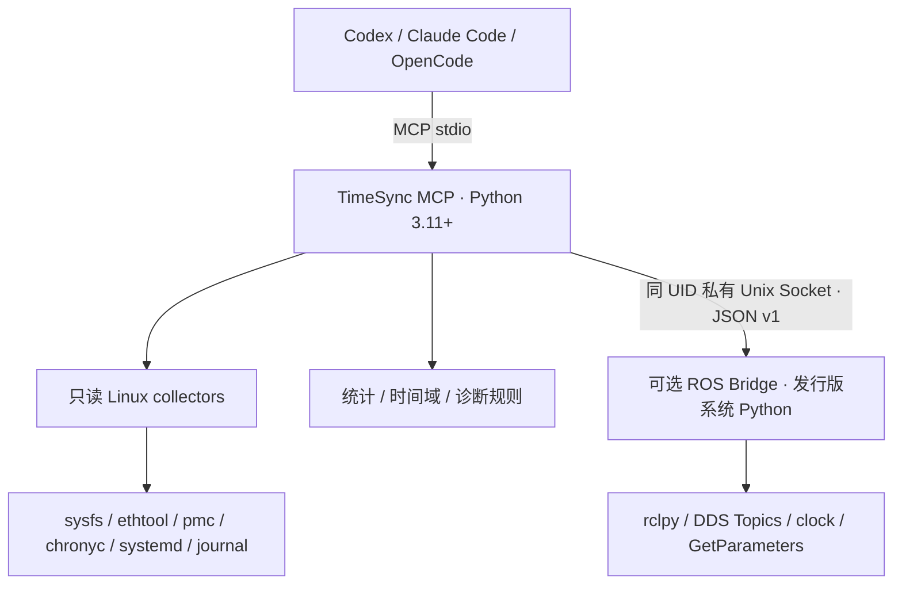

# TimeSync MCP

[](https://github.com/tiansongyu/TimeSync-MCP/actions/workflows/ci.yml)
[](pyproject.toml)
[](LICENSE)

面向 Linux、ROS 2、Jetson 和机器人系统的**只读时间同步诊断 MCP Server**。检查 PTP/Chrony、PHC 能力、ROS Header 时间戳，使用可追溯的观测与确定性规则生成报告。无需云端推理服务。

[English](README_EN.md) · [快速入门](docs/quickstart.md) · [文档导航](docs/index.md) · [安装](docs/installation.md) · [工具参考](docs/mcp-tools.md) · [验证记录](docs/validation.md)

当前版本 **0.1.0 / Alpha**：可以安装、通过 stdio 被真实 MCP 客户端调用。Linux 采集、独立 ROS Bridge、周期分析、显式时钟映射、稳健漂移拟合和报告均已实现。设备专有适配见限制，未声称实机同步精度。

## 核心功能与适用系统

- 普通用户检查网卡、硬件时间戳/PHC、LinuxPTP GET 数据集、Chrony CSV、systemd 和有限 journald 日志。
- ROS 2 可选独立进程：发现 Topic、QoS/标准 Header，采集 Header 与 Subscriber callback 的两条时间序列。
- 周期统计、MAD、P95/P99、倒退/重复/异常大间隔，一对一双 Topic 配对。
- 显式 Clock Domain Graph、有效区间内的线性映射、可信配对事件下的稳健 Offset/Drift 拟合。
- 规则诊断、JSON/Markdown 报告、15 个 MCP Tools、4 个 Prompts。

适合有 Linux 主机、相机、IMU、LiDAR 或独立设备时钟的机器人系统。无需假定所有设备共享时钟；EtherCAT DC、PTP、ROS Time 必须分别建模。

## 架构



MCP 环境不导入 `rclpy`。Humble Bridge 使用 Python 3.10，Jazzy 使用其发行版 Python。官方 MCP SDK **2.3.0** 使用 `MCPServer`/`Client`；SDK 实际要求 Python ≥3.10，本项目核心要求 ≥3.11，默认 3.12。[接口依据](docs/research.md)

## 安装与运行

先安装 [uv](https://docs.astral.sh/uv/getting-started/installation/)，从下方公开仓库地址克隆。

```bash
git clone https://github.com/tiansongyu/TimeSync-MCP.git timesync-mcp
cd timesync-mcp
uv sync --locked
uv run timesync-mcp doctor
uv run timesync-mcp serve
```

已 source ROS 的终端运行核心测试/Server 时，应使用 `env -u PYTHONPATH uv run ...`，避免发行版 Python 插件进入 MCP 虚拟环境。ROS Bridge 则在单独终端运行：

```bash
source /opt/ros/humble/setup.bash
/usr/bin/python3 ros_bridge/run.py
```

没有 ROS、LinuxPTP 或 Chrony 时核心仍可运行，缺失数据返回 `unavailable`；不会启动守护进程。系统工具安装由用户管理，TimeSync 不申请 root。

## MCP 客户端

以下命令中的路径必须换成实际绝对路径。Codex 示例已用安装的 CLI 验证 add/get，协议调用用官方 SDK 的新旧协议路径验证。

```bash
codex mcp add timesync -- \
  uv run --directory /absolute/path/to/timesync-mcp \
  timesync-mcp serve
```

Claude Code：

```bash
claude mcp add --scope project --transport stdio timesync -- \
  uv run --directory /absolute/path/to/timesync-mcp timesync-mcp serve
```

OpenCode 使用 [opencode.json](examples/opencode/opencode.json) 的 `mcp.timesync.type="local"` 和命令数组。各客户端配置格式不同；版本、连接验证与限制记录在 [validation.md](docs/validation.md)。需要时将 `--config /absolute/path/robot_config.toml` 加在 `serve` 后。

## 工具与示例

| 类别 | Tools |
| --- | --- |
| Linux | `list_network_interfaces`, `get_timestamp_capabilities`, `get_ptp_status`, `get_chrony_status`, `inspect_time_services`, `get_time_sync_logs` |
| ROS 2 | `list_ros_topics`, `inspect_ros_topic`, `analyze_ros_timestamps`, `compare_ros_topics`, `inspect_ros_clock` |
| 分析与报告 | `analyze_timestamp_series`, `inspect_clock_domains`, `generate_time_sync_report`, `get_diagnostic_capabilities` |

完整输入、输出与错误语义见 [工具参考](docs/mcp-tools.md)。Prompts：`diagnose_ptp`、`diagnose_camera_imu_sync`、`diagnose_ros_timestamp_jitter`、`diagnose_robot_time_sync`。

- “检查 enp7s0 的 PTP domain 0”：先检查 capability，再 GET PTP 数据集。UDS 指向守护进程，不能据接口参数声称已验证端口关联。
- “采样 /imu/data 10 秒，Header 是否接近 400 Hz”：调用 `analyze_ros_timestamps`，分别查看 Header 周期和 callback 到达周期。
- “左右相机是否满足 100 µs Header 对齐”：先确认并配置时间域，再使用 `compare_ros_topics` 的 `tolerance_ns=100000`；同时查看未匹配数。通过目标不代表曝光时刻已对齐。
- 离线合成序列：`analyze_timestamp_series({"timestamps_ns":[0,2500000,5000000],"expected_rate_hz":400,"synthetic":true})`，这里表示工具名与 JSON 参数，不是 Python 调用语法。

## 时间戳概念

`CLOCK_REALTIME` 可被校时；`CLOCK_MONOTONIC` 无 UTC 原点；PHC 可能采用 PTP 时间尺度；ROS `/clock` 可以暂停或倒退；设备 tick、EtherCAT DC 不自动等于 ROS Time。**时钟同步、Header 对齐、曝光/采样同步是不同问题**。

未知时钟域禁止绝对比较。拟合需要共同事件、硬件或经过验证的映射证据；近邻时间戳不足以证明同步。纳秒整数表示分辨率，不表示纳秒精度；未知不确定度为 `null`。[理论](docs/time-sync-theory.md) · [时钟域](docs/clock-domains.md)

## 平台与已知限制

| 平台 | 状态 |
| --- | --- |
| Ubuntu 22.04 x86_64 / Python 3.12 / ROS Humble Python 3.10 | 本地软件与真实 DDS 合成测试已验证 |
| Python 3.11 | 兼容性验证见 validation.md |
| Ubuntu 24.04 / ROS Jazzy | 独立发行版容器 CI 已通过，限软件/DDS 合成验证 |
| ARM64 / Jetson | 设计目标，未做实机验收 |
| PHC / PTP Grandmaster / 双目曝光 / IMU 实体采样 | 未做硬件验收 |

专有 GMSL/HTE、SOEM/IgH、rosbag2、多机聚合和历史分析暂不实现；提供可选适配接口与传感器语义模型，缺失不会阻止核心运行。不会自动校时或修改 ROS 参数。通用 Bridge 没有标准序列号字段，在线配对支持 exact/tolerance；共同事件编号配对可通过独立分析函数接入。

## 安全

默认只有 stdio；没有 HTTP 监听、通用 Shell Tool、`sudo` 或写时钟操作。固定命令族使用 argv 执行，限制超时、输出与并发。Bridge 检查 UID，目录 `0700`、socket `0600`；采样最多 30 秒、默认每 Topic 20,000 个时间戳、两个活动请求和一个 ROS worker。日志视为不可信文本并尽力脱敏。[安全边界](docs/security.md)

## 测试与贡献

```bash
env -u PYTHONPATH uv run pytest
```

```bash
uv run ruff check src tests ros_bridge scripts
uv run ruff format --check src tests ros_bridge scripts
uv run mypy
uv build
uv build ros_bridge
```

真实 ROS 测试仅在匹配的发行版 Python 可用时运行，否则明确 skip；其输入标注 Synthetic。算法用固定种子恢复注入的 20 ppm / 5 ms，测试限定误差；这不是硬件成绩。人工硬件验收见 [hardware-acceptance.md](docs/hardware-acceptance.md)。贡献流程见 [CONTRIBUTING.md](CONTRIBUTING.md)。

## 许可证

[Apache-2.0](LICENSE)。依赖锁定于 [uv.lock](uv.lock)，第三方许可证清单见 [THIRD_PARTY_NOTICES.md](THIRD_PARTY_NOTICES.md)。尚未上传 PyPI。
