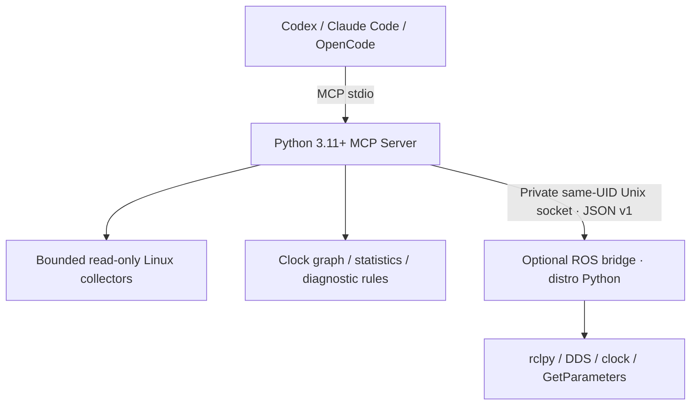

# TimeSync MCP

[](https://github.com/tiansongyu/TimeSync-MCP/actions/workflows/ci.yml)
[](pyproject.toml)
[](LICENSE)

An open-source, **read-only MCP server** for inspecting, analyzing, and diagnosing clock synchronization and sensor timestamp issues in robotics systems.

[中文](README.md) · [Quickstart](docs/quickstart.md) · [Documentation](docs/index.md) · [Installation](docs/installation.md) · [Tools](docs/mcp-tools.md) · [Validation](docs/validation.md)

Version **0.1.0 / Alpha** is an installable stdio server with 15 structured tools, four workflow prompts, Linux collectors, an optional standalone ROS bridge, clock-domain analysis, and deterministic diagnostic reports. It requires no cloud inference service.

## Features and intended systems

Inspect sysfs/ethtool timestamp and PHC capabilities; LinuxPTP read-only GET datasets; Chrony tracking/sources/sourcestats; allowlisted systemd services and bounded journal logs. Analyze ROS Header and monotonic callback-arrival intervals separately, including population statistics, MAD, percentiles, repeats, backwards stamps, and suspected anomalous intervals. Compare compatible timestamp domains with one-to-one exact or tolerance matching. Fit rate and offset only from explicitly corresponding events.

Intended for Linux/ROS 2 robots, Jetson hosts, cameras, IMUs and LiDARs with potentially independent clocks. Sensor semantics and optional adapter protocols are included. GMSL, Jetson HTE, EtherCAT SOEM/IgH, rosbag2, multi-host aggregation and history adapters are future extensions.

## Architecture



The core never imports rclpy. Humble uses its system Python 3.10 in a separate process; Jazzy uses its matching Python. The official SDK is pinned to **mcp 2.3.0**, using `MCPServer` and `Client`. The SDK itself supports Python ≥3.10; this project core deliberately requires ≥3.11 and defaults to 3.12.

## Install and run

Install [uv](https://docs.astral.sh/uv/getting-started/installation/), then clone the public repository:

```bash
git clone https://github.com/tiansongyu/TimeSync-MCP.git timesync-mcp
cd timesync-mcp
uv sync --locked
uv run timesync-mcp doctor
uv run timesync-mcp serve
```

In ROS-sourced terminals, run the core with `env -u PYTHONPATH uv run ...` to exclude foreign Python plugins. Run the bridge separately:

```bash
source /opt/ros/humble/setup.bash
/usr/bin/python3 ros_bridge/run.py
```

Missing ROS/PTP/Chrony is reported as unavailable evidence; other features remain usable. System package installation is managed by the user. No daemon is started automatically.

## MCP clients

Replace the checkout path:

```bash
codex mcp add timesync -- \
  uv run --directory /absolute/path/to/timesync-mcp timesync-mcp serve

claude mcp add --scope project --transport stdio timesync -- \
  uv run --directory /absolute/path/to/timesync-mcp timesync-mcp serve
```

OpenCode uses the `type: "local"` command-array configuration in [examples](examples/opencode/opencode.json). Client configuration formats differ. Exact tested versions and connection results are recorded in [validation.md](docs/validation.md). Add `--config /absolute/path/robot_config.toml` after `serve` to use operator-provided clock mappings.

## Tools and usage

| Area | Tools |
| --- | --- |
| Linux | list_network_interfaces, get_timestamp_capabilities, get_ptp_status, get_chrony_status, inspect_time_services, get_time_sync_logs |
| ROS | list_ros_topics, inspect_ros_topic, analyze_ros_timestamps, compare_ros_topics, inspect_ros_clock |
| Analysis | analyze_timestamp_series, inspect_clock_domains, generate_time_sync_report, get_diagnostic_capabilities |

Every tool returns a versioned structured result with provenance, status and warnings. See the [complete input/output/error reference](docs/mcp-tools.md). Prompts: `diagnose_ptp`, `diagnose_camera_imu_sync`, `diagnose_ros_timestamp_jitter`, `diagnose_robot_time_sync`.

Example requests: inspect PTP on `enp7s0` domain 0; sample `/imu/data` for 10 seconds against 400 Hz; compare stereo Header timestamps against 100 µs after confirming the clock domains. Successful Header alignment does not prove exposure alignment. `analyze_timestamp_series` accepts offline integer nanoseconds and an explicit `synthetic` flag.

## Timestamp interpretation

CLOCK_REALTIME is adjustable; CLOCK_MONOTONIC is not UTC; PHC can use a PTP timescale; ROS `/clock` can pause or jump. Device ticks and EtherCAT DC are independent domains until measured mappings establish otherwise. **Clock synchronization, Header alignment and physical sample synchronization are separate questions.** Nanosecond resolution is not nanosecond accuracy. Unknown uncertainty remains `null`.

Unknown clock domains cannot be compared. Nearest stamps do not establish clock synchronization. Different sensor rates introduce sampling phase effects. Callback jitter is subscriber observation, not measured hardware sample jitter. See [theory](docs/time-sync-theory.md) and [clock domains](docs/clock-domains.md).

## Platforms and limitations

Ubuntu 22.04 x86_64, Python 3.12, and standalone Humble Python 3.10 have local software/DDS validation with Synthetic publishers. Python 3.11 compatibility results are in the validation record. Ubuntu 24.04/Jazzy have separate CI jobs, not a claimed local result. ARM64/Jetson and PHC/Grandmaster/exposure/physical IMU sampling remain hardware-unverified. Use the [manual acceptance guide](docs/hardware-acceptance.md).

PTP UDS queries address a daemon; the requested interface does not establish its port association. Standard ROS 2 Header has no sequence field; the online bridge supports exact/tolerance timestamp matching. Event-ID matching is available in the independent analysis API. Reports are snapshots with engineering thresholds, not continuous servo verification.

## Security

Ordinary user, stdio only, no general shell tool or automatic clock/service/network/robot changes. Fixed read-only argv families have deadlines, output and concurrency bounds. Same-UID bridge access requires a `0700` directory and `0600` socket. Samples are bounded to 30 seconds and a default 20,000 timestamps/topic. Logs are untrusted and redacted best effort. See [security](docs/security.md).

## Testing and contribution

```bash
env -u PYTHONPATH uv run pytest
uv run ruff check src tests ros_bridge scripts
uv run ruff format --check src tests ros_bridge scripts
uv run mypy
uv build
uv build ros_bridge
```

Tests include documented-format Synthetic fixtures, robust 20 ppm / 5 ms recovery, actual MCP stdio calls in modern/legacy modes, socket permission/cancellation bounds and actual ROS DDS tests when a matching system Python is available. ROS tests skip explicitly otherwise. Synthetic results are not hardware performance. See [CONTRIBUTING.md](CONTRIBUTING.md).

## License

[Apache-2.0](LICENSE). Locked dependencies: [uv.lock](uv.lock). [Third-party notices](THIRD_PARTY_NOTICES.md). The source repository is public; no PyPI publication is claimed.
