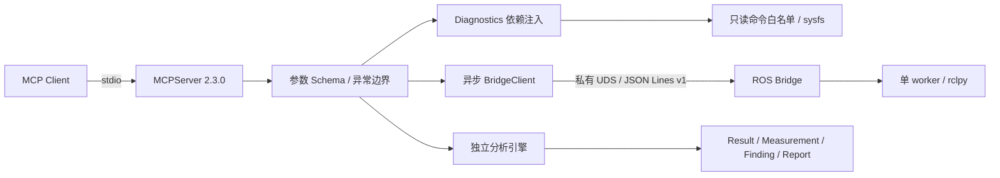

# 架构与实现边界

核心 Python 3.11+ 与 ROS 发行版 Python 分进程，Linux 功能不依赖 ROS。此文描述现有实现；硬件适配与持续状态历史属于扩展建议，不是已完成能力。

- `server.py` 注册工具、Prompts、只读 Resource，SDK 从类型注解生成 JSON Schema；业务可直接调用分析函数或 Collector。
- `collectors/` 独立解析 ethtool、pmc、chronyc；Runner Protocol 可注入 Fixture。Linux 读取 sysfs；systemd/journal 使用受限 CLI。
- `security/command_runner.py` 仅允许固定命令族。整个命令（包括等待并发槽）有 deadline，stdout+stderr 共用字节预算；取消会 kill/wait 子进程。
- `analysis/` 负责统计、周期、配对、时钟映射和确定性诊断，不依赖 MCP 或 rclpy。
- `models/` 使用 Pydantic v2；结果 Schema 版本 `1.0`，IPC 版本 `1`，两者相互独立。
- `ros_bridge/` 是可单独构建的无 Python 第三方依赖包；rclpy 由 ROS 发行版提供。一个 worker 独占 Node，避免跨线程操作；两个活动 IPC 请求，超限明确拒绝。Topic 采样仅保存 Header 和 monotonic callback 时间戳。
- `devices/` 的 `SensorAdapter` Protocol 与 SensorDescription 为可选设备模块入口。核心不自动发现/执行第三方 entry points；应用必须显式加载可信适配器，避免插件副作用。

## 事实与推断

PTP UDS 查询作用于 ptp4l daemon，不能仅通过 `interface` 参数确认端口归属。因此结果始终包含 `interface_association_verified=false`，保留 responding port，等待用户核对配置。

systemd 服务共存不自动产生“争用”结论；尚未解析所有服务配置文件。配置的 ClockGraph 是操作员声明，不是本工具独立完成的硬件测量。配置推断边不会用于跨域换算。

报告默认采集 Linux 服务、Chrony，以及可选接口的 ethtool/PTP 观测；指定 topics 时还会添加 ROS 采样与 Header 周期观测；它不是后台持续监控。独立规则引擎也接受离线或 ROS 周期分析产生的 Result。

## 资源界限

核心默认命令超时 4 s、总输出 256 KiB、4 个命令并发；Bridge 每请求 1–2 个 Topic、0.1–30 s、默认每 Topic 20,000 条保留时间戳，上限 100,000。IPC 请求 16 KiB、响应 8 MB；写出最多 2 s、关闭最多 1 s，避免慢客户端占用工作槽。ROS 发现最多 512 Topic、每 Topic 64 个 endpoint；参数查询最多 32 个节点、全局等待 0.5 s，未获取返回 unknown。

统计输入最多 100,000 个 int64 ns。图最多 128 域/256 边。图关系只沿显式方向使用，不自动外推或反推；多路径冲突需由配置提供者解决。
