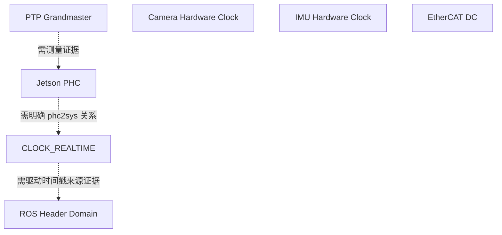

# 时钟域、变换与可信对应关系

同一数值不能仅凭“看起来像 Unix 时间”就判断为 UTC。ClockDomain 包含 id/name/type、timescale/origin、host/device、是否单调/可调整、同步机制、参考域与 metadata；具体字段以 `models/clock.py` 为准。

支持 SYSTEM_REALTIME、SYSTEM_MONOTONIC、SYSTEM_MONOTONIC_RAW、PTP_HARDWARE_CLOCK、PTP_GRANDMASTER、NTP_REFERENCE、ROS_TIME、ROS_SIM_TIME、DEVICE_HARDWARE_CLOCK、ETHERCAT_DC、UNKNOWN。未知类型无法参与绝对比较。



这些虚线是待验证关系示例，不是工具自动发现或已经确认的拓扑。共享 Jetson 不意味着共享采样时钟。

## 配置与实际换算

使用 TOML `graph.domains`、`graph.transformations` 和 `topic_clock_domains` 显式声明。`examples/robot_config.toml` 是教学配置，不能未经核实就用于真实相机判断。

每条 ClockTransformation 记录 source/target、relative_rate、source/target anchor ns、method/evidence、kind、有效源时间区间、样本量、拟合残差、不确定度、hardware_verified、timescale。内部采用：

```text
t_target = target_anchor_ns + a * (t_source - source_anchor_ns)
b = target_anchor_ns - a * source_anchor_ns
```

这等价于 `t_target=a*t_source+b`，但避免对巨大 Unix 纳秒数直接做低精度浮点运算。变换计算使用 Decimal，最后舍入到整数纳秒；量化不等于测量精度。

- `configuration_inference` 边只展示，不用于换算。
- `measured` 边只在自身有效源时间范围内使用。只沿记录方向使用；没有自动逆变换或外推。
- 没有配置、UNKNOWN 域、没有有效测量路径，返回 `invalid`，原因包含“Cannot establish trusted mapping”。
- 同一已配置域可以直接比较；配置真实性由操作员提供。已观测到 simulation publisher 时，UTC/系统域配置会被拒绝。

## 漂移拟合

`analyze_timestamp_series` 的可选 paired_timestamps_ns 要求等长、严格递增、至少三个可信对应事件，并提供 `correspondence_method`（common_events/hardware_verified/validated_mapping）和 evidence。近邻匹配不是可接受方法。

算法以源首点中心化，广间隔斜率中位数初始化，三轮 MAD 剔除和最小二乘；输出 relative rate、drift ppm、首源锚点的 offset、残差 RMS、inlier 数和有效范围。工具将外部 evidence 标注为调用方声明，`hardware_verified=false`，不会把一句声明当成已完成实验。

拟合 residual 仅反映模型对配对数据的拟合程度。源采样不确定度、触发延迟、路径非对称和计量参考可能未知，因此 `uncertainty_ns=null`。样本不足时不给稳定尾部统计的承诺。算法数值验收使用明确标注 Synthetic 的测试。
